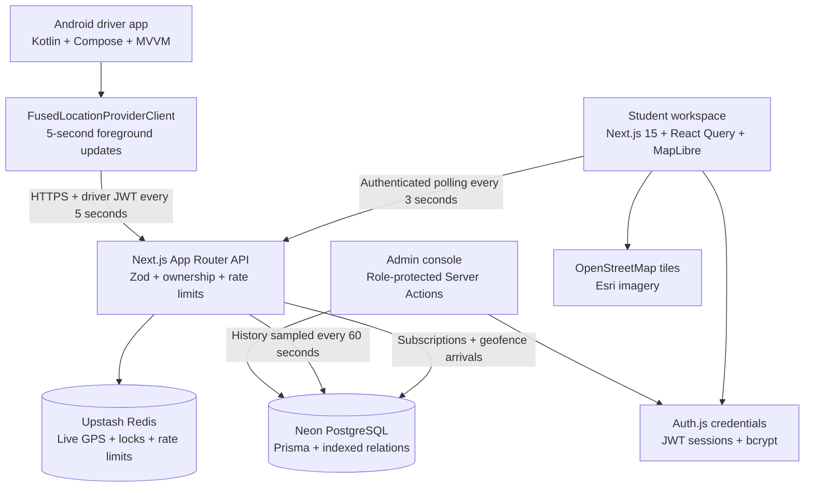
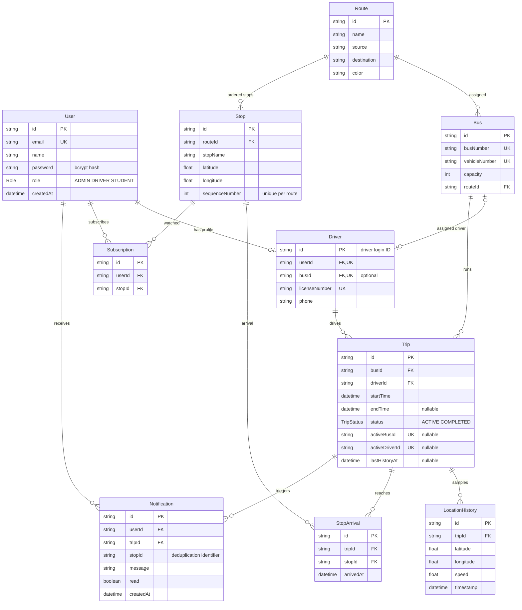
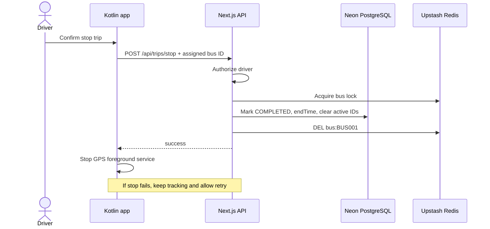

# Smart College Bus Tracking System

IIIT BusPulse is a college transportation workspace with a Next.js web/API application and a native Kotlin driver application. The web app is demonstrable without cloud credentials through explicit `DEMO_MODE=true`. Production mode uses PostgreSQL and Redis; it does not silently fall back to simulation.

## System Architecture



## Ownership And Storage

- Students read active/inactive buses, routes, timings, and their own subscriptions/notifications.
- Drivers have separate short-lived, audience-restricted JWTs. Every write checks the current driver role and assigned bus in PostgreSQL.
- Admins manage routes, stops, buses, driver assignments, and users. Mutating Server Actions repeat authorization; hiding navigation is not a security boundary.
- Redis `bus:BUS001` stores `{latitude, longitude, speed, heading, updatedAt, tripId}` with a 90-second TTL. Only active trips can write it. Stopped trips delete it; readers reject locations with a different trip ID.
- A location older than 30 seconds is stale. Its ETA is withheld and its live marker is hidden.
- History stores at most one accepted location per 60-second sampling slot. An atomic conditional `Trip.lastHistoryAt` update decides whether to insert history inside a database transaction.
- A 100-meter geofence upserts one `StopArrival` per trip/stop. A 1-km proximity check inserts one `Notification` per user/trip/stop, using a unique constraint and `skipDuplicates`.
- Bus and driver active IDs have nullable unique constraints. They are cleared on stop; concurrent duplicate active trips cannot be created.
- Start, stop, and ingestion share a per-bus Redis lock. The lease is 30 seconds; token-checked deletion cannot remove a different owner's lock. Keep ingestion within that lease. Very large fleets should use a durable queue plus fencing/advisory locks rather than increasing synchronous work indefinitely.

## ER Diagram



## Driver Login And Trip Start

```mermaid
sequenceDiagram
    actor Driver
    participant App as Kotlin app
    participant API as Next.js API
    participant DB as Neon PostgreSQL
    participant Redis as Upstash Redis
    Driver->>App: Driver ID + password
    App->>API: POST /api/driver/login
    API->>Redis: Rate-limit login ID
    API->>DB: Driver + current user role + assignment
    API->>API: bcrypt verification
    API-->>App: 8-hour HS256 driver JWT
    App->>App: Encrypt token using Android Keystore
    Driver->>App: Start trip
    App->>App: Request precise foreground location permission
    App->>API: POST /api/trips/start + Bearer token
    API->>DB: Recheck role and assigned bus
    API->>Redis: Acquire bus lock; clear old location
    API->>DB: Create ACTIVE trip with unique active IDs
    API-->>App: Active trip
    App->>App: Start location foreground service
```

## Location, ETA, And Notifications

```mermaid
sequenceDiagram
    participant App as Driver foreground service
    participant API as Next.js API
    participant Redis as Upstash Redis
    participant DB as Neon PostgreSQL
    participant Web as Student dashboard
    loop Approximately every 5 seconds
        App->>API: POST /api/location with fresh fix
        API->>API: Verify JWT, ownership, timestamp, and coordinates
        API->>Redis: Acquire bus lock; read last accepted timestamp
        API->>DB: Find owned ACTIVE trip
        alt New sampling slot
            API->>DB: Atomic sample claim + LocationHistory insert
        end
        alt Within 100 meters
            API->>DB: Upsert StopArrival
        end
        alt Within 1 kilometer
            API->>DB: Insert notifications, skip duplicate unique keys
        end
        API->>Redis: SET bus:BUS001, TTL 90 seconds
        API-->>App: accepted
    end
    loop Every 3 seconds while dashboard is visible
        Web->>API: GET /api/buses
        API->>DB: Fleet metadata + active trip IDs
        API->>Redis: MGET active bus locations
        API-->>Web: Locations, freshness status, campus ETA
        Web->>Web: Update markers and selected-stop ETA
        Web->>API: GET /api/notifications
        API->>DB: Current user's notifications
        API-->>Web: Arrival messages
    end
```

## Trip Stop



## ETA And Map Scope

Haversine provides straight-line distance. ETA uses distance divided by a clamped GPS speed (12-60 km/h), multiplied by a 1.3 traffic allowance. It returns `null` when no fresh fix exists and `0` inside 100 meters. The selected-stop calculation is shared by the API and UI. This is a phase-one approximation, not a road-routing or timetable prediction.

MapLibre displays actual raster map assets, route stop-to-stop polylines, bus markers, stops, and the IIIT Dharwad campus. Stop-to-stop lines are not guaranteed to follow roads. For a real deployment, add surveyed route geometry and optionally an OpenRouteService road-distance adapter, caching estimates per bus/stop. Real `ON_TIME` status currently means fresh tracking data, not schedule adherence; `DELAYED` is demo-only until timetables are modeled.

## Scalability

Fleet reads batch Redis keys with `MGET` and use indexed trip relations. API calls are stateless and run on Vercel's Node runtime. PostgreSQL uses Neon pooling; Prisma is reused within an instance. Student polling is appropriate for a pilot, but thousands of simultaneous students need cached fleet metadata, request coalescing, cursor pagination, and a push channel (Ably/Pusher/managed WebSockets). Do not host a persistent WebSocket server or background timer in a Vercel function.

Notifications are durable **in-app alerts** in real mode, polled while the dashboard is open. Demo mode can additionally show browser notifications when permission is granted. Closed-browser push delivery is not implemented; add a service worker, VAPID/Web Push or FCM, a durable outbox, retries, and delivery metrics for that requirement.

Analytics cover recent trip durations, completed-trip route popularity, daily distinct buses, and driver trip counts/averages. History is capped at 100 records per response; analytics at 5,000 recent trips. Adopt database aggregates and pagination before fleet-wide long-term reporting. GPS history retention, audit logging, emergency operations, telemetry, and load testing must be configured before a college pilot.
